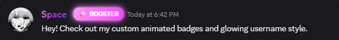
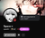

# Badge Creator (Message Decorations) 🎨

A Vencord userplugin that lets you design, customize, animate, and sync custom chat badges and username glowing effects across Discord.

## Features ✨

- **Custom Badge Designer**: Create up to 8 badges with customizable text, colors, gradient backgrounds, borders, and glow effects.
- **Animated Badges**: Smooth wave gradient animations and pulse effects.
- **Name Customization**: Add text glow and animation presets (pulse, rainbow, shine) to your username.
- **Global Synchronization**: Cloudflare Worker + KV storage backend for real-time syncing between you and your friends.
- **Voice Radar-style Dark UI**: Sleek, clean modal editor with live preview in chat style.
- **Context Menus & Commands**:
  - Right-click any user -> "Open in Badge Creator"
  - Right-click profile -> "Edit Profile Badges"
  - Slash commands: `/badgecreator`, `/badges`, `/decorations`

## Installation 🚀

1. Clone or copy this folder into your Vencord `src/userplugins/` directory:
   ```bash
   cd Vencord/src/userplugins
   git clone https://github.com/salamangueeeeee/Badge-Creator.git
   ```
2. Build Vencord:
   ```bash
   pnpm build
   ```
3. Restart or re-inject Discord via Vencord Installer.
4. Enable **Badge Creator** in Vencord Settings -> Plugins.

<p align="center">
  
</p>

<p align="center">
  
</p>


## License

GPL-3.0

